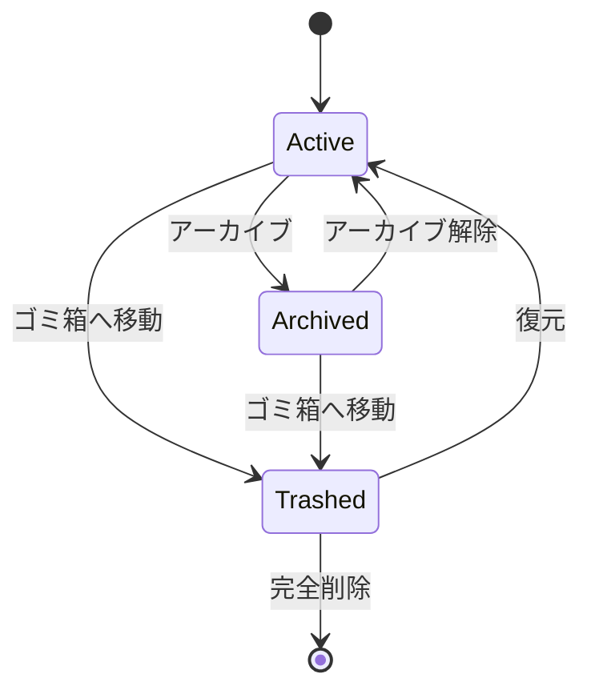

# メモライフサイクル・自動保存・設定機能 要件定義／設計／実装計画

- 状態: Implemented（Must完了、Should一部完了）
- 対象リリース: 2026-08-10実装
- 作成日: 2026-08-10
- 関連ADR: [`../adr/0002-memo-lifecycle-autosave-and-preferences.md`](../adr/0002-memo-lifecycle-autosave-and-preferences.md)
- 前提仕様: [`memo-discovery.md`](./memo-discovery.md)

## 実装結果（2026-08-10）

- Must要件として、お気に入り、アーカイブ、ゴミ箱、復元、ゴミ箱限定の完全削除、競合検出付き自動保存、離脱警告、プロフィール、テーマ、プレースホルダー整理を実装した。
- `memos`のライフサイクル列とrevision、`profiles`、owner限定RLS／列権限、`search_memos_v2`、原子的な保存関数をバージョン管理されたSupabaseマイグレーションで適用した。
- Should要件のうち、更新日・作成日・タイトルによる並び順と、保存失敗後に使える明示保存を実装した。ナビゲーション件数、ゴミ箱移動Undo、検索ショートカットは未実装であり、誤解を招くキーヒントは表示していない。
- Jest／React Testing Libraryで状態導出、URL、query、Action、RLSマイグレーション、UI、競合、自動保存、テーマ、離脱警告を検証した。Playwright MCPでは認証済み実ブラウザで作成、編集、自動保存、お気に入り、アーカイブ、ゴミ箱、復元、完全削除、テーマ永続化、390px／1440px、ライト／ダーク、フォーカス、横方向オーバーフローを確認した。

## 1. 背景と実装前の現状

策定時点のTagNoteは、認証、Markdownメモの作成・一覧・詳細・編集・完全削除、カテゴリ、タグ、本文検索、複合フィルタまで実装済みだった。一方、日常的にメモを蓄積する段階で必要になる次の機能が不足していた。

1. 重要なメモを固定的に見つけるお気に入り機能
2. 現在は使わないメモを保持したまま一覧から外すアーカイブ機能
3. 誤削除から復旧できるゴミ箱機能
4. 編集中の入力を通信失敗や画面移動から守る自動保存と未保存警告
5. 実ユーザー情報と、ライト／ダーク表示を手動選択できる設定画面
6. 押せるように見えるが動作しないプレースホルダーUIの解消

策定時点の接続先Supabaseでは、`public.memos`、`public.categories`、`public.tags`、`public.memo_tags` がRLS有効で存在した。`memos` はライフサイクル列や競合検出用リビジョンをまだ持たず、削除は所有者が即時DELETEできる状態だった。実装では既存データを変更せず、nullable列と安全な既定値を使う加算変更を採用した。

## 2. 優先順位とスコープ

### 2.1 今回のMust

- お気に入りの登録・解除とお気に入り一覧
- アーカイブ・解除とアーカイブ一覧
- ゴミ箱への移動、復元、ゴミ箱内からの完全削除
- 通常一覧、最近のメモ、検索結果からアーカイブ／ゴミ箱を除外
- 既存メモ編集時の競合検出付き自動保存
- 保存中、保存済み、未保存、失敗、競合の明示
- 未保存状態での再読み込み、タブ終了、アプリ内移動への警告
- `/settings` での表示名とテーマ設定
- `system / light / dark` の3種類のテーマ選択と永続化
- サイドバーのサンプルプロフィールを認証ユーザー情報へ置換
- 未実装操作を非表示または実ルートへ接続

### 2.2 Should

- `⌘K`／`Ctrl+K` でヘッダー検索へフォーカスし、Escapeで解除
- お気に入り、アーカイブ、ゴミ箱の件数をナビゲーションへ表示
- 一覧の並び順を更新日、作成日、タイトルから選択
- ゴミ箱移動直後に復元できるUndo導線
- 自動保存失敗後の明示的な再試行

### 2.3 今回の対象外

- 複数メモの一括操作
- ゴミ箱の自動削除期限、定期ジョブ
- 共有メモ、共同編集、リアルタイムカーソル
- 新規メモをDB上の無題ドラフトとして自動作成する処理
- 履歴の全世代保存、差分表示、任意時点への復元
- 通知センター、課金プラン、プロフィール画像アップロード
- メールアドレス変更、アカウント完全削除、管理者機能
- リスト／グリッド表示切替そのもの
- タイトル検索や検索ランキングの変更

対象外の操作を画面へ残す場合は、押せるボタンとして表示しない。将来機能を示す必要がある場合だけ、操作不能であることが明確な説明文として表示する。

## 3. ゴールと成功指標

### 3.1 プロダクトゴール

- 誤操作でメモを失わず、ゴミ箱から自力で復旧できる。
- メモ件数が増えても、重要・保管・削除予定の状態を迷わず区別できる。
- 編集結果が保存済みかを常に判断でき、複数タブの上書きを検出できる。
- OS設定に加え、ユーザーがサイト内で表示テーマを選べる。
- 画面上のすべての操作が、表示された名称どおりの結果を持つ。

### 3.2 初期成功指標

- 通常の編集で、最後の入力から2秒以内に保存済み表示へ到達する割合が99%以上
- 自動保存失敗が無表示のまま画面遷移するケースが0件
- 通常一覧、検索、お気に入りにゴミ箱メモが混入するケースが0件
- 他ユーザーの状態変更、復元、完全削除がRLSまたはDB制約で拒否されること
- 390px／1440px、ライト／ダーク、キーボードで主要操作が完結すること

## 4. 用語と状態モデル

| 用語 | 定義 |
| --- | --- |
| アクティブ | `archived_at is null` かつ `trashed_at is null` のメモ |
| お気に入り | `favorited_at is not null` のメモ。アーカイブ／ゴミ箱中も値は保持する |
| アーカイブ | `archived_at is not null` かつ `trashed_at is null` のメモ |
| ゴミ箱 | `trashed_at is not null` のメモ |
| 復元 | ゴミ箱メモの `trashed_at` をnullにし、アクティブへ戻す操作 |
| 完全削除 | ゴミ箱内のメモ行をDELETEし、復元不能にする操作 |
| リビジョン | 内容・カテゴリ・タグの保存成功ごとに増える競合検出用の整数 |
| Dirty | 画面上の値が、最後にDBへ保存されたリビジョンと一致していない状態 |

### 4.1 状態遷移



- ゴミ箱へ移動すると `archived_at` はnullにする。復元先は常にアクティブとする。
- `favorited_at` はアーカイブ／ゴミ箱移動で消さず、復元後も保持する。ただしゴミ箱一覧ではお気に入り操作を提供しない。
- ライフサイクル操作だけでは本文の `updated_at` を変更しない。「最近のメモ」の順序を状態整理だけで変えないためである。

## 5. 機能要件

### 5.1 お気に入り

| ID | 優先度 | 要件 |
| --- | --- | --- |
| FAV-01 | Must | 所有するアクティブまたはアーカイブ済みメモのお気に入りを登録・解除できる。 |
| FAV-02 | Must | `/memos?view=favorites` はお気に入りかつアクティブなメモだけを表示する。 |
| FAV-03 | Must | メモカードと詳細画面に、名称付きまたはアクセシブル名付きのお気に入り操作を表示する。 |
| FAV-04 | Must | 更新中の二重操作を防ぎ、成功・失敗を操作の近くまたは共通トーストで通知する。 |
| FAV-05 | Must | 他ユーザーのメモIDを指定しても状態を変更せず、存在有無を漏らさない。 |
| FAV-06 | Should | お気に入り一覧の既定順は `favorited_at desc, id desc` とする。 |

### 5.2 アーカイブ

| ID | 優先度 | 要件 |
| --- | --- | --- |
| ARC-01 | Must | 所有するアクティブメモをアーカイブし、アーカイブ済みメモを解除できる。 |
| ARC-02 | Must | アーカイブしたメモはホーム、通常一覧、お気に入り一覧から除外する。 |
| ARC-03 | Must | `/memos?view=archive` はアーカイブ済みかつゴミ箱外のメモだけを表示する。 |
| ARC-04 | Must | アーカイブ済みメモは詳細表示と編集を行える。編集してもアーカイブ状態を維持する。 |
| ARC-05 | Must | アーカイブ一覧の既定順は `archived_at desc, id desc` とする。 |
| ARC-06 | Must | アーカイブ操作はメモ本文の更新日時を変更しない。 |

### 5.3 ゴミ箱と完全削除

| ID | 優先度 | 要件 |
| --- | --- | --- |
| TRASH-01 | Must | 所有するアクティブ／アーカイブ済みメモをゴミ箱へ移動できる。 |
| TRASH-02 | Must | ゴミ箱メモはホーム、通常一覧、お気に入り、アーカイブ、通常検索から除外する。 |
| TRASH-03 | Must | `/memos?view=trash` はゴミ箱メモだけを `trashed_at desc, id desc` で表示する。 |
| TRASH-04 | Must | ゴミ箱メモを復元するとアクティブへ戻り、カテゴリ、タグ、お気に入り、本文を保持する。 |
| TRASH-05 | Must | ゴミ箱メモの詳細は読み取り専用とし、編集前に復元を求める。 |
| TRASH-06 | Must | 完全削除はゴミ箱内のメモにだけ許可し、実行前に復元不能であることを確認ダイアログで明示する。 |
| TRASH-07 | Must | ゴミ箱外のメモにDELETEを直接実行してもDBのRLSで拒否する。 |
| TRASH-08 | Must | 完全削除では既存FKどおり対象の`memo_tags`だけを削除し、カテゴリとタグ自体は保持する。 |
| TRASH-09 | Must | 空状態には、ゴミ箱が空である説明と通常一覧へ戻る導線を表示する。 |
| TRASH-10 | Should | ゴミ箱移動後のトーストに、同一メモを復元するUndo操作を提供する。 |

### 5.4 自動保存と離脱保護

| ID | 優先度 | 要件 |
| --- | --- | --- |
| SAVE-01 | Must | 既存メモ編集では、タイトル、本文、カテゴリ、タグの変更後1秒間入力がなければ自動保存する。 |
| SAVE-02 | Must | 保存はメモ本体とタグ差し替えを1トランザクション内で実行する。 |
| SAVE-03 | Must | 保存要求には最後に取得した`revision`を含め、一致する場合だけ更新してリビジョンを1増やす。 |
| SAVE-04 | Must | 別タブ等で先に更新されていた場合は上書きせず、「別の場所で更新されました」と競合状態を表示する。 |
| SAVE-05 | Must | 状態を「未保存」「保存中…」「保存済み」「保存できませんでした」「競合」の文言で表示し、`aria-live="polite"`で通知する。 |
| SAVE-06 | Must | 保存中にさらに変更された場合、同時保存を増やさず、完了後に最新値を1回保存する。 |
| SAVE-07 | Must | 通信失敗時に入力値を保持し、手動再試行と従来の明示的な保存ボタンを残す。 |
| SAVE-08 | Must | タイトル空や上限超過など検証エラー中は不正値を送信せず、Dirty状態と入力エラーを維持する。 |
| SAVE-09 | Must | Dirtyまたは保存失敗中に再読み込み／タブ終了する場合は`beforeunload`で警告する。 |
| SAVE-10 | Must | Dirtyまたは保存失敗中のアプリ内移動・サインアウトは共有ナビゲーションガードで確認し、残る／破棄して続行を選べる。 |
| SAVE-11 | Must | 保存成功後だけ離脱警告を解除する。保存開始だけでは解除しない。 |
| SAVE-12 | Must | ゴミ箱メモへの保存をDB関数で拒否する。アーカイブ済みメモは保存できる。 |
| SAVE-13 | Must | 新規作成は従来どおり明示保存とし、未保存時の離脱警告だけを適用する。 |
| SAVE-14 | Should | 一時的通信失敗は1回だけ短いバックオフ後に再試行し、その後はユーザー操作を待つ。 |

### 5.5 並び順

| ID | 優先度 | 要件 |
| --- | --- | --- |
| SORT-01 | Should | アクティブ／お気に入り一覧で、更新日の新しい順、作成日の新しい順、タイトル昇順を選べる。 |
| SORT-02 | Should | 選択値はURLの`sort`へ保持し、共有・再読み込み・戻る操作で再現する。 |
| SORT-03 | Should | 不正な値は既定順へ正規化し、DBへSQL断片として渡さない。 |
| SORT-04 | Should | アーカイブ／ゴミ箱は状態変更日時順を既定とし、初期版では並び替え対象外とする。 |

### 5.6 設定とプロフィール

| ID | 優先度 | 要件 |
| --- | --- | --- |
| SET-01 | Must | `/settings`を認証必須ページとして追加する。 |
| SET-02 | Must | 表示名をtrim後1〜50文字で保存できる。未設定時は認証メールのローカル部を画面上のフォールバックにする。 |
| SET-03 | Must | サイドバーにはハードコード値ではなく、自分の表示名とメールアドレスを表示する。 |
| SET-04 | Must | テーマは「システム設定」「ライト」「ダーク」の3択とする。 |
| SET-05 | Must | ライト／ダークを選んだ場合はOS設定より優先し、システム設定では`prefers-color-scheme`へ追従する。 |
| SET-06 | Must | テーマは初回描画前に反映し、ライトからダークへ点滅する表示を避ける。 |
| SET-07 | Must | 設定はユーザー単位でSupabaseへ保存し、別端末でサインインしても反映する。 |
| SET-08 | Must | 設定取得失敗時はシステム設定へフォールバックし、保存失敗時は選択値と再試行導線を保持する。 |
| SET-09 | Must | 他ユーザーのプロフィール／設定はRLSで読み書きできない。 |
| SET-10 | Must | 公開／未認証画面はOSのテーマ設定へ追従し、個人設定を推測しない。 |

### 5.7 プレースホルダーUIの解消

| ID | 優先度 | 要件 |
| --- | --- | --- |
| UI-01 | Must | お気に入り、アーカイブ、ゴミ箱、設定のナビゲーションを実ルートへ接続する。 |
| UI-02 | Must | 「クイックメモを開く」は`/memos/new`への実リンクに置き換える。 |
| UI-03 | Must | 通知ボタン、グリッド表示切替、プラン表示は、実装するまで操作UIから削除する。 |
| UI-04 | Must | アカウントメニューは`/settings`への導線へ置き換える。 |
| UI-05 | Should | 表示している`⌘K`／`Ctrl+K`ショートカットを実装し、未対応環境では誤解を招くキーヒントを表示しない。 |

## 6. ルートとURL契約

| ルート | 用途 | 主なパラメータ |
| --- | --- | --- |
| `/` | アクティブな最近のメモ3件 | なし |
| `/memos` | アクティブな通常一覧 | `q`, `category`, `tags`, `page`, `sort` |
| `/memos?view=favorites` | アクティブなお気に入り一覧 | 通常一覧と同じ条件 |
| `/memos?view=archive` | アーカイブ一覧 | `q`, `category`, `tags`, `page` |
| `/memos?view=trash` | ゴミ箱一覧 | `q`, `page` |
| `/memos/[id]` | 状態に応じた詳細表示 | なし |
| `/memos/[id]/edit` | アクティブ／アーカイブメモの自動保存編集 | なし |
| `/settings` | 表示名・テーマ設定 | なし |

- `view`の許可値は`active / favorites / archive / trash`とし、省略時は`active`とする。URL上は既存互換のためアクティブを省略する。
- 現在の`/?view=...`は廃止し、すべて`/memos?view=...`へ統一する。
- ビュー、検索、カテゴリ、タグ、並び順はANDで合成する。
- ページ移動時は条件を保持し、ビューまたは条件変更時は`page=1`へ戻す。

## 7. 画面・操作設計

### 7.1 共通シェル

- デスクトップとモバイルのナビゲーションで同じ実ルートを提供する。
- 選択中のビューは既存`NavigationLink`の選択状態で明示する。
- 件数は補助情報として表示し、取得失敗時に`0`と偽装しない。
- 実プロフィールは表示名、メール、設定導線の順に示す。架空のプラン名を表示しない。

### 7.2 メモカードと詳細

- カード全体リンクとお気に入りボタンの操作領域・フォーカス順が競合しない構造にする。
- 固定高、プレーンテキスト抜粋、カテゴリ・タグ表示を維持する。
- 状態は色だけに依存せず、「アーカイブ済み」「ゴミ箱」等のラベルと操作文言で示す。
- ゴミ箱詳細では編集ボタンを出さず、「復元」「完全に削除」を主要操作にする。
- 完全削除確認は既存ダイアログパターンを再利用し、対象名、復元不能、関連タグ／カテゴリが消えないことを説明する。

### 7.3 編集画面

- ページ見出し付近に保存状態を常時表示する。
- 保存失敗と競合は赤系の明示メッセージ、通常の未保存／保存中はニュートラル、保存済みは控えめな成功表示とする。
- 競合時は「最新の内容を読み直す」と「現在の入力をコピーする」を提供する。初期版で強制上書きは提供しない。
- 自動保存があっても明示的な「変更を保存」ボタンを残し、支援技術と不安定な通信環境のユーザーへ確実な操作を提供する。

### 7.4 設定画面

- 既存のページコンテナ、カード、ラジオグループ、フィードバック表現を再利用する。
- テーマ選択は3つのラジオカードとし、名称と挙動を併記する。
- テーマ変更は即時プレビューし、保存失敗時はDB上の確定値へ戻すか再試行を明示する。
- 390px／1440px、ライト／ダーク、200%拡大、キーボードで検証する。

## 8. データ設計

### 8.1 `public.memos`の加算変更

| 列 | 型 | 制約／用途 |
| --- | --- | --- |
| `favorited_at` | `timestamptz null` | お気に入り登録日時 |
| `archived_at` | `timestamptz null` | アーカイブ日時 |
| `trashed_at` | `timestamptz null` | ゴミ箱移動日時 |
| `revision` | `bigint not null default 1` | 内容保存の楽観ロック。1以上 |

追加制約:

```sql
check (revision >= 1)
check (trashed_at is null or archived_at is null)
```

追加インデックス候補:

```text
(owner_id, updated_at desc, id desc) where archived_at is null and trashed_at is null
(owner_id, favorited_at desc, id desc) where favorited_at is not null and archived_at is null and trashed_at is null
(owner_id, archived_at desc, id desc) where archived_at is not null and trashed_at is null
(owner_id, trashed_at desc, id desc) where trashed_at is not null
```

- 実際のインデックスは代表クエリの`EXPLAIN`で確認し、既存インデックスとの重複を避ける。
- ライフサイクル列の更新では`updated_at`を変更しない。
- 既存4件を含む全行は、アクティブ、未お気に入り、`revision = 1`として互換性を保つ。

### 8.2 `public.profiles`

| 列 | 型 | 制約／用途 |
| --- | --- | --- |
| `owner_id` | `uuid` | PK、`auth.users(id) on delete cascade` |
| `display_name` | `text null` | trim済み1〜50文字。nullは認証情報へフォールバック |
| `theme` | `text` | NOT NULL、`system / light / dark`、既定`system` |
| `created_at` | `timestamptz` | NOT NULL、`now()` |
| `updated_at` | `timestamptz` | NOT NULL、設定更新時に更新 |

- 全ユーザーへ一括バックフィルせず、設定の初回保存時にowner ID付きでupsertする。
- `auth.users`のメールアドレスを`profiles`へ複製しない。
- RLSを有効化し、SELECT／INSERT／UPDATEを`auth.uid() = owner_id`へ限定する。
- authenticatedには`display_name`と`theme`だけのUPDATE列権限を与える。DELETEは直接付与せず、Authユーザー削除時のcascadeだけを使う。

### 8.3 DB関数

#### `search_memos_v2`

- 既存関数を利用中のアプリとのデプロイ互換性を保つため、新しい関数名で追加する。
- `memo_view`と`sort_key`を検証済みテキストで受ける。
- ビューごとの状態条件をSQL内で固定し、ユーザー入力からORDER BY断片を組み立てない。
- 返却値へライフサイクル日時と`revision`を追加する。

#### `save_memo_revision`

- `memo_id`、`expected_revision`、タイトル、本文、カテゴリID、タグID配列を受ける。
- `owner_id = auth.uid()`、`revision = expected_revision`、`trashed_at is null`を満たす行だけ更新する。
- メモ更新とタグ差し替えを同一トランザクションで行い、成功時に`revision + 1`と新しい`updated_at`を返す。
- 0行更新時は、not found、trashed、revision conflictをアプリが区別できる固定ステータスで返す。ただし他ユーザー行はnot found相当に統一する。
- `security invoker`、空の`search_path`、authenticatedだけへのEXECUTEを維持する。

### 8.4 完全削除のDB境界

- DELETE RLSを`auth.uid() = owner_id and trashed_at is not null`へ変更する。
- ゴミ箱外のDELETEは、旧画面や直接APIから実行しても拒否する。
- アプリの完全削除Actionもowner ID、memo ID、`trashed_at is not null`で限定し、削除0件はnot found相当にする。

## 9. アプリケーション設計

### 9.1 型と純粋ロジック

- `MemoView`、`MemoSort`、URL解析、状態ラベル、許可操作を`lib/memos/`の純粋なモジュールへ集約する。
- DBのnullable日時から`active / archived / trashed`を導出する関数を1つの正本にする。
- `MemoRecord`へライフサイクル日時と`revision`を追加し、一覧・詳細・編集で別定義を作らない。
- `ThemePreference`とプロフィール検証を`lib/settings/`へ置く。

### 9.2 Server Actions

| Action | 責務 |
| --- | --- |
| `toggleFavoriteAction` | owner限定でお気に入り日時を設定／解除 |
| `archiveMemoAction` | アーカイブ日時を設定 |
| `unarchiveMemoAction` | アーカイブ日時を解除 |
| `trashMemoAction` | `archived_at`を解除し`trashed_at`を設定 |
| `restoreMemoAction` | `trashed_at`を解除してアクティブへ戻す |
| `deleteTrashedMemoAction` | ゴミ箱内だけを完全削除 |
| `autosaveMemoAction` | 検証後に`save_memo_revision`を呼び、新revisionを返す |
| `updateProfileAction` | 表示名とテーマをowner付きでupsert |

- すべて`getClaims()`で認可し、クライアントからowner IDを受け取らない。
- 成功後は`/`、`/memos`、対象詳細、必要な設定／シェルデータを再検証する。
- DBエラーをそのまま表示せず、再試行可能、競合、not found、unauthenticatedへ変換する。

### 9.3 自動保存クライアント

- エディタ状態を`lastSavedSnapshot`と`currentSnapshot`で比較し、Dirtyを導出する。
- 1秒のdebounce後にActionを呼ぶ。保存中の変更は`queued`フラグでまとめる。
- 応答のrevisionが期待値どおりの場合だけ`lastSavedSnapshot`を更新する。
- コンポーネントunmountだけを保存成功とみなさない。
- ナビゲーションガードはApp Routerの当該バージョンの公式ガイドを実装時に確認し、共通シェル、サインアウト、編集画面の戻るリンク、プレビュー内リンクを同じ契約へ接続する。
- `beforeunload`はDirty／error時だけ登録し、通常時のブラウザ移動を妨げない。

### 9.4 テーマ適用

- CSSは`data-theme="light"`と`data-theme="dark"`を明示指定として扱い、属性なし／`system`は`prefers-color-scheme`へ追従する。
- 認証済みレイアウトはプロフィール設定をサーバーで取得し、初回HTMLの`<html>`へテーマ属性を設定する。
- 未認証時は属性を強制せずOS設定へ追従する。
- 保存操作はUIを先に切り替えてもよいが、失敗時に確定値と不一致のまま放置しない。

## 10. セキュリティとプライバシー

- 新規テーブルでRLSを必須とし、`auth.uid()`を用いたowner限定ポリシーを設定する。
- owner ID、メール、リビジョン、状態日時をクライアント入力から信頼しない。
- UPDATEは列権限を限定し、`owner_id`、`created_at`を更新可能にしない。
- 完全削除はゴミ箱条件をアプリとRLSの両方で保証する。
- 競合エラーで他ユーザーのメモ存在や更新日時を返さない。
- 自動保存する本文や検索語をアプリケーションログ、分析イベントへ記録しない。
- プロフィール名はReactの通常エスケープを維持し、HTMLとして解釈しない。
- スキーマ変更後に生成型、Security Advisor、Performance Advisorを確認する。

## 11. 非機能要件

### 11.1 アクセシビリティ

- 状態操作には具体的なアクセシブル名を付ける。
- 保存状態は色やアイコンだけでなく文言とライブリージョンで通知する。
- 確認ダイアログは初期フォーカス、Escape、キャンセル後のフォーカス復帰を保証する。
- テーマ選択はfieldset／legend／radioで実装する。
- 390px、1440px、200%拡大、キーボードのみ、ライト／ダークで確認する。

### 11.2 信頼性

- 通信失敗を保存成功に見せない。
- 自動保存の多重実行を避け、遅い応答で新しい入力を古い内容へ戻さない。
- 別タブ競合はlast-write-winsにせず、ユーザーへ通知する。
- DB関数内の一部失敗でタグだけ、新本文だけが保存された状態を残さない。
- 状態変更後の一覧再検証失敗時も、操作結果と再読み込み方法を明示する。

### 11.3 性能

- シェルのプロフィール取得とカテゴリ取得は認証確認後に並列実行し、不必要な直列DB往復を増やさない。
- 自動保存は入力ごとに通信せずdebounceし、同時リクエストは1件に制限する。
- 各ビューは24件ページングと1 DB往復の集約取得を維持する。
- 部分インデックス導入前後を代表データで`EXPLAIN (ANALYZE, BUFFERS)`比較する。

## 12. TDD・検証計画

### 12.1 純粋ロジック／コンポーネント

- ビュー解析: 未指定、4許可値、不正値、既存条件との組み合わせ、ページリセット
- 状態導出: active、favorite、archived、trashed、不正なarchive+trash
- 並び順: 許可値、不正値、ビューごとの既定値
- 保存状態: pristine、dirty、saving、queued、saved、error、conflict
- 自動保存: debounce、保存中再編集、検証エラー、再試行、古い応答の無視
- 離脱保護: Dirty時だけ警告、保存成功後解除、キャンセル時入力保持
- 設定: 表示名検証、3テーマ、未設定フォールバック、保存失敗
- UI: カードと詳細の許可操作、ゴミ箱読み取り専用、ダイアログ文言、ライブリージョン

### 12.2 Server Action

- unauthenticated、not found、owner限定、DB失敗、成功時再検証
- ゴミ箱外の完全削除拒否
- revision一致保存、競合、保存中のゴミ箱移動競合
- 他所有者カテゴリ／タグを含む保存拒否
- profile初回insert、既存update、他所有者アクセス拒否

### 12.3 DB統合

Supabaseの開発ブランチまたはローカルDBで最低限次を自動検証する。

1. 既存メモがアクティブかつrevision 1で保持される。
2. 各ライフサイクル状態の検索関数が期待する行だけ返す。
3. 他ユーザーのfavorite、archive、trash、restore、delete、saveを拒否する。
4. ゴミ箱外DELETEを拒否し、ゴミ箱内DELETEだけ成功する。
5. 復元後も本文、カテゴリ、タグ、お気に入りが保持される。
6. 同じrevisionの2保存は片方だけ成功する。
7. 保存関数の途中失敗でメモとタグがロールバックされる。
8. profilesのRLS、列権限、制約が有効である。
9. 各ビューの代表クエリが想定インデックスを利用する。

### 12.4 Playwright MCP

- お気に入り登録／解除と一覧への出入り
- アーカイブ、編集、解除
- ゴミ箱移動、通常一覧からの消失、復元、完全削除
- 検索・カテゴリ・タグと各ビューの組み合わせ、再読み込み、戻る／進む
- 入力後の自動保存表示、低速通信、失敗再試行、別タブ競合
- Dirty状態のアプリ内移動、再読み込み警告、キャンセル
- テーマ3種、再読み込み、別ルート、ライト／ダーク初期表示
- 実表示名のシェル反映とサンプルプロフィールの不在
- 390px／1440px、キーボード、モーション軽減、コンソールエラー0件

## 13. 段階的実装計画

各PhaseはRed → Green → Refactorで進め、独立してレビュー・ロールバック可能にする。

### Phase 0: 契約固定と誤解を招くUIの整理

1. ビュー、状態、並び順、テーマ、保存状態の純粋型と失敗テストを書く。
2. 既存ボタン／リンクの振る舞いテストを追加する。
3. クイックメモを実リンク化し、通知、グリッド切替、プラン表示を一旦削除する。
4. `/memos?view=`と`/settings`のルート契約をテストで固定する。

完了条件: 押せるUIに未実装操作がなく、後続DB実装の契約がRedテストで表現される。

### Phase 1: ライフサイクルDB基盤

1. `memos`へ3日時列とrevisionを追加するマイグレーションを書く。
2. 制約、列権限、owner限定RLS、ゴミ箱外DELETE拒否を追加する。
3. 部分インデックスと`search_memos_v2`を追加する。
4. lifecycle ActionのDB統合テストを先に書く。
5. Supabase開発ブランチで適用し、既存行、RLS、Advisors、生成型を確認する。

完了条件: UIなしでも所有者が安全に状態遷移でき、既存データが無変更で読める。

### Phase 2: お気に入りの縦切り

1. Action／queryの失敗テストを書く。
2. 詳細とカードへお気に入り操作を追加する。
3. `/memos?view=favorites`とナビゲーションを接続する。
4. 空、Loading、error、二重操作を実装する。
5. Playwrightで登録、一覧、解除を確認する。

完了条件: お気に入りの全導線が実データで動き、他ビューを壊さない。

### Phase 3: アーカイブとゴミ箱の縦切り

1. 状態遷移、ビュー分離、DELETE制約の失敗テストを書く。
2. アーカイブ／解除、ゴミ箱移動／復元を実装する。
3. ゴミ箱詳細を読み取り専用にし、完全削除をゴミ箱へ限定する。
4. 旧即時削除Actionと文言を新契約へ置き換える。
5. 検索・フィルタ・ページングとの組み合わせを確認する。

完了条件: 誤削除を復元でき、ゴミ箱外の完全削除がDBでも不可能になる。

### Phase 4: 競合検出付き自動保存

1. 保存状態機械とdebounceのJest fake timerテストを書く。
2. `save_memo_revision`とActionの競合テストを書く。
3. 編集フォームへ自動保存とライブステータスを追加する。
4. 共有ナビゲーションガードと`beforeunload`を実装する。
5. 低速、オフライン、別タブ、検証エラーをPlaywrightで確認する。

完了条件: 通常編集は自動保存され、失敗・競合・離脱で入力を黙って失わない。

### Phase 5: プロフィールとテーマ設定

1. profilesマイグレーションとRLSテストを書く。
2. 設定query／Actionと検証テストを書く。
3. `/settings`と3テーマの即時プレビューを実装する。
4. RootLayoutの初期テーマとシェルの実プロフィールを接続する。
5. 390px／1440px、テーマ3種、再読み込み、取得失敗を確認する。

完了条件: テーマが点滅なく永続化され、サンプルユーザー表示が完全に消える。

### Phase 6: 並び順・ショートカット・ハードニング

1. 許可済み並び順をURLとDB関数へ追加する。
2. `⌘K`／`Ctrl+K`とEscapeを実装する。
3. ルートLoading／Error Boundary、オフライン文言を補完する。
4. 自動Playwright E2E、DB統合テスト、CIを追加する。
5. 代表データの性能、アクセシビリティ、Advisorsを確認する。

完了条件: MustとShouldの対象項目が自動／実ブラウザ検証へ対応付けられる。

## 14. リリースとロールバック

- スキーマはnullable列、既定revision、新関数の順に加算し、旧検索関数を直ちに削除しない。
- ゴミ箱外DELETEを拒否する変更は安全側に倒す。旧クライアントでは削除が失敗する可能性を許容し、意図しない完全削除を優先して防ぐ。
- 新アプリが`search_memos_v2`へ切り替わったことを確認後、旧関数廃止を別マイグレーションで検討する。
- UIロールバック時もライフサイクル列とprofilesを削除しない。データ損失を避け、旧UIが無視できる状態で保持する。
- 自動保存に問題があれば機能フラグで明示保存へ戻せるよう、従来の保存ボタンとActionを移行期間中維持する。
- 適用前後で総メモ件数、状態別件数、RLS、主要クエリ、Advisorsを比較する。

## 15. リスクと対策

| リスク | 影響 | 対策 |
| --- | --- | --- |
| 旧削除導線と新ゴミ箱の混在 | 意図しない完全削除 | DBのDELETE条件を先に安全側へ変更し、旧Actionを同一リリースで置換 |
| 自動保存の応答順逆転 | 新しい入力を古い値で上書き | 単一in-flight、revision、応答revision確認 |
| 複数タブ編集 | 黙った上書き | 楽観ロックで競合表示し、初期版では強制上書きしない |
| 状態条件追加で検索漏れ | ゴミ箱混入、件数不一致 | 状態別DB統合テストと統合検索関数への集約 |
| シェルの追加プロフィール取得 | 初期表示遅延 | 認証後の並列取得、必要列限定、計測 |
| 初期テーマの点滅 | 品質低下、目の負担 | サーバーHTMLでテーマ属性を確定 |
| ゴミ箱が無期限に増える | 容量増加 | 初期版は手動完全削除。利用状況計測後に保持期限を別仕様化 |
| 保存失敗中の移動 | 入力損失 | Dirtyガード、明示ステータス、入力保持 |

## 16. Definition of Done

- Must要件がJest、DB統合テスト、Playwrightのいずれかへ対応付けられている。
- アクティブ、お気に入り、アーカイブ、ゴミ箱がowner限定で正しく分離される。
- ゴミ箱外の完全削除がDB境界で拒否される。
- 自動保存は競合を検出し、失敗を成功として表示しない。
- 未保存入力が警告なしに失われない。
- テーマ3種が初回表示、再読み込み、画面遷移で一貫する。
- サンプルプロフィールと未実装操作UIが残っていない。
- 既存Markdown、カテゴリ、タグ、検索、固定高カード、URL条件が回帰していない。
- 390px／1440px、ライト／ダーク、200%拡大、キーボード、モーション軽減を確認する。
- `npm test`、`npm run typecheck`、`npm run lint`、`npm run build`が成功する。
- Supabaseマイグレーション、RLS、生成型、Security／Performance Advisorsを確認する。
- AGENTS.md、Design System、関連ADRを実装結果へ同期する。

## 17. 参考資料

- [Supabase: Row Level Security](https://supabase.com/docs/guides/database/postgres/row-level-security)
- [Supabase: Column Level Security](https://supabase.com/docs/guides/database/postgres/column-level-security)
- [Supabase: Managing User Data](https://supabase.com/docs/guides/auth/managing-user-data)
- [PostgreSQL: Row Security Policies](https://www.postgresql.org/docs/current/ddl-rowsecurity.html)
- [PostgreSQL: Explicit Locking](https://www.postgresql.org/docs/current/explicit-locking.html)
